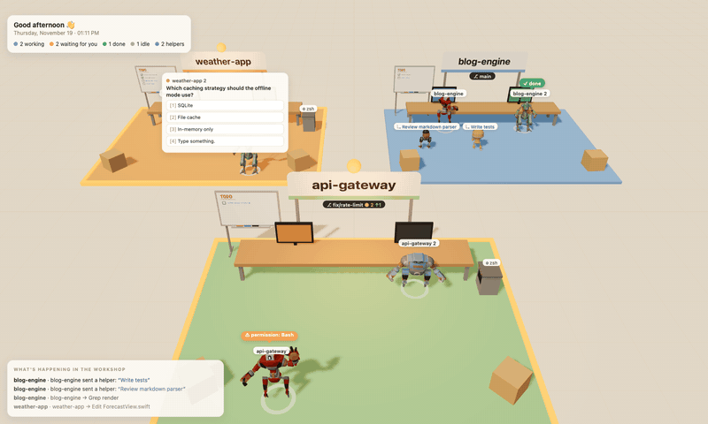
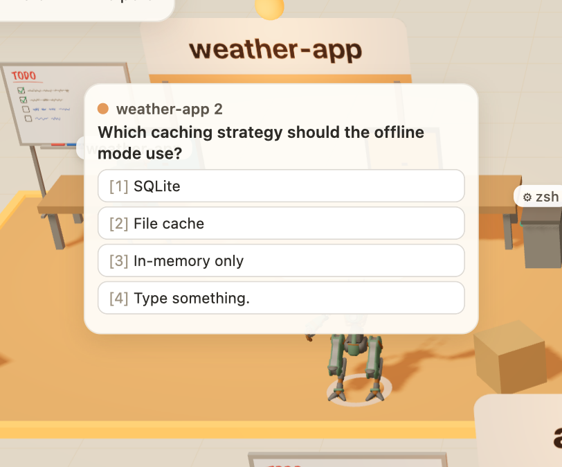

# Agent Workshop

**A macOS app that turns your Claude Code sessions into a 3D robot workshop — with built-in floating terminals,
answer-from-the-scene prompts, git status, token/cost tracking and seamless multi-account support.**

[Türkçe README](README.tr.md)



Every Claude Code session is a robot. Robots gather in zones by project: they work at the bench while
Claude is busy, wave at you when it needs you, and rest when the job is done. When an agent asks for
permission, asks a question or wants a plan approved, the options appear in a balloon above its project —
click one and the answer goes straight to the agent, even if that session runs in another terminal app.

---

## Features

### 🤖 Robot workshop
- Every open Claude Code session is a robot, placed in a zone per project (git root).
- States at a glance: **working** (with the tool it is using), **waiting for you** (and what for), **done**,
  **idle**. Subagents show up as small helpers next to their robot.
- The zone panel shows recent tool calls, open `TODO.local.md` items and git status. Commits, pushes,
  pulls and branch switches appear in the scene and the activity feed.
- **6 robots** (George, Mike, Stan for main agents; Leela, Android, Bolt for subagents), or bring your own
  `.glb` model from the **Robots** window. Animations are matched by name (Idle, Walk/Run, Wave, Sit, Yes…).

### 💬 Answer from the scene


- Permission requests, questions (single/multi select, free text, multi-page) and plan approvals appear in a
  balloon over the project. Click an option (or press 1–9) and the answer goes to the agent.
- Works for **every** session — in Agent Workshop's own terminals and in any other terminal app — through a
  small Claude Code `PermissionRequest` hook (opt-in, see [What it changes](#what-it-changes-on-your-mac)).
  The menu in the terminal stays open too; whichever you answer first wins.
- "Open plan" shows the plan in the built-in Markdown reader.

### ⚙️ Run cards
- Commands you run often — `./deploy.sh`, a build, the tests — become the project's cards. Add them from the
  **Cards** window in the top bar with a name, a command and an **Ask first** setting. Cards live in
  `RUN.local.json` at the project root (git ignores it by default).
- Each platform has a machine rack in its back right corner with one gear per card: click it and the command runs
  in the project folder, its output streaming into a floating terminal window. The gear spins orange while it
  runs and stops when it ends — a green flash on success, red on failure.
- With **Ask first** on (the default for new cards) you're asked before anything runs, for jobs that are hard to
  undo. Clicking a card that's already running doesn't start it twice; it brings its terminal forward.
- Commands run in the background helper, so they keep going if you quit Agent Workshop. If the helper is an older
  version the card isn't run and you're offered a helper restart.

```json
{"cards":[{"id":"…","name":"Deploy","command":"./deploy.sh","confirm":true}]}
```

### 🪟 Floating terminal windows
- Terminals live inside the app, on top of the workshop: drag, resize, snap to halves/quarters, double-click
  for full screen. Click the scene and every window flies back to its project in the sidebar.
- As many Claude sessions, shells, read-only **Git** views (changes, commits, diffs) and **Markdown**
  readers per project as you like.
- Terminals live in a separate helper process (`atolye-host`), so your sessions survive restarting the app.
- After you build a new version, Agent Workshop notices the running helper is outdated and offers to restart it
  (or use **Terminals › Restart helper…**). Open terminals close; Claude sessions in the workshop reopen where they
  left off (`--resume`).

### 🔔 Never miss a waiting agent
- The waiting agent's window and sidebar label pulse, with a sound.
- macOS notification while the app is in the background; click it to jump to that terminal.
- Waiting-agent count on the Dock icon.

### 💰 Tokens and cost
- Tokens per session and their value at Anthropic API list prices (subagents included); today's total in the
  toolbar, across closed sessions and all accounts.
- On a subscription this is not a bill — it is for comparing how much work each session did.

### 👥 Several Claude accounts, one environment
- Profiles (`Profile 1`, `Profile 2`, …) in the **Profiles** window from the top bar — one card per account with its limits, sign-in and expected account; new sessions open with the selected profile.
- All profiles share the **same** skills, plugins, settings, memory and history. MCP servers and project
  permissions are synced between profiles; credentials are never touched.
- 5-hour and weekly limits per profile, how long until each resets, and a warning past 90%.

### 🟩 GitHub dashboard
- A personal dashboard: a year of contributions, today, last 7 days, current and longest streak,
  commit / PR / review totals, and the repositories you worked on in the last 30 days.
- Sign-in uses GitHub's device flow; the token stays in your Keychain and only read requests are made.

---

## Install

**Requirements:** macOS 26, Xcode 26 (Swift 6.2), [Claude Code](https://claude.com/claude-code), and `jq`
for the usage-limit display (`brew install jq`).

```sh
git clone https://github.com/alican645/agent-workshop.git
cd agent-workshop
./scripts/build-atolye.sh --install   # builds "build/Agent Workshop.app" and copies it to ~/Applications
open ~/Applications/"Agent Workshop.app"
```

On first launch Agent Workshop asks before changing anything in your Claude Code setup; you can change
that choice later from the app menu (**Claude Code integration…**).

The app is not notarized. Built from source it just works; the build script signs with your first
"Apple Development" identity if you have one (otherwise ad-hoc, and macOS may ask for Keychain access on
each new build).

The UI is in English and Turkish (**Language** in the app menu). Translations live in
`Sources/Atolye/Web/i18n/en.json`; missing ones are caught by the tests.

```sh
swift test
node --test Tests/web/*.test.mjs   # scene logic
```

## Shortcuts

| Shortcut | Action |
|---|---|
| ⌘⇧T | New Claude session in the front project |
| ⌘T | New terminal |
| ⌘W | Close window (asks if something is running) |
| ⌘M | Send window back to its project |
| ⌘1 … ⌘9 | Bring the Nth window to front |
| ⌘\` · ⌘[ · ⌘] | Cycle through windows |
| ⌃⌘S | Show / hide the sidebar |

## How it works

Agent Workshop sends no data anywhere; it reads Claude Code's own local files. The only exception is the
GitHub dashboard, which reads your own contributions from GitHub if you sign in.

- **Session state:** Claude Code's session registry (`<profile>/sessions/<pid>.json`), scanned every second.
- **What an agent is doing:** the tail of the conversation logs (`projects/**/*.jsonl`) — tool calls,
  subagents and token usage.
- **Prompts:** the `PermissionRequest` hook forwards the request to the app over a local Unix socket and
  waits for your answer. For sessions in Agent Workshop's own terminals the visible screen is also read.
- **Git:** the `git` CLI, read-only and without taking locks (`--no-optional-locks`).

### What it changes on your Mac

Only with your consent (first launch, or **Claude Code integration…**). The original of every file it
changes is copied to `~/Library/Application Support/Atolye/yedek/` first.

- `~/.claude/settings.json`: a `PermissionRequest` hook (plus `PostToolUse`/`PostToolUseFailure` to notice
  answers given in the terminal) running `~/Library/Application Support/Atolye/bin/atolye-hook`. When the
  app is not running the hook does nothing. Your own hooks are left untouched.
- `~/.claude/statusline-command.sh`: a short block that saves `rate_limits` per profile, for the limit display.
- For extra profiles: symlinks to shared items in `~/.claude`, and only the MCP / project-permission fields
  of each profile's `.claude.json` (three-way merge; skipped while Claude is writing the file).

Turning an option off removes what it added.

## Project layout

| Target | What |
|---|---|
| `Atolye` | The SwiftUI app; the scene is three.js in a `WKWebView` (`Sources/Atolye/Web`) |
| `atolye-host` | Background helper that hosts the terminals (Unix socket) |
| `atolye-hook` | The Claude Code hook: forwards prompts to the app and returns your answer |
| `AtolyeHostKit` | Helper and hook server/client code, with [SwiftTerm](https://github.com/migueldeicaza/SwiftTerm) |
| `AtolyeCore` | UI-independent core: session scanning, prompts, git, usage/cost, profiles, sync |

## Credits

- [three.js](https://threejs.org) (MIT) and the *RobotExpressive* model — Tomás Laulhé (Quaternius),
  modifications by Don McCurdy (CC0).
- Robots George, Leela, Mike, Stan (*Animated Mech Pack*) and Android (*Cyberpunk Game Kit*) —
  [Quaternius](https://quaternius.com) (CC0). Details: `Sources/Atolye/Web/models/LICENSE.txt`.
- [SwiftTerm](https://github.com/migueldeicaza/SwiftTerm) (MIT), [marked](https://marked.js.org) (MIT).
- Some ideas (like token/cost tracking) were inspired by Orbiterm; no code was shared.

Agent Workshop is an independent project and is not affiliated with Anthropic.

## License

[MIT](LICENSE) © 2026 Ali Can Aydın
