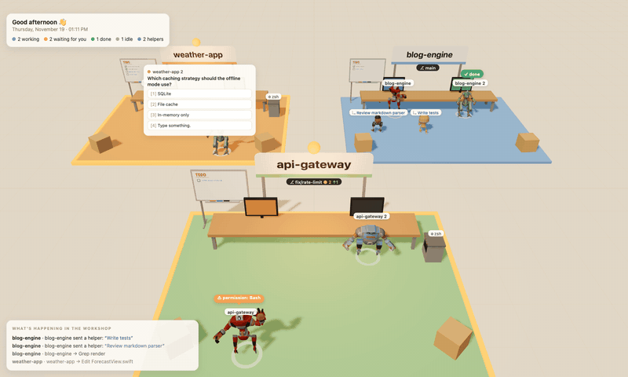
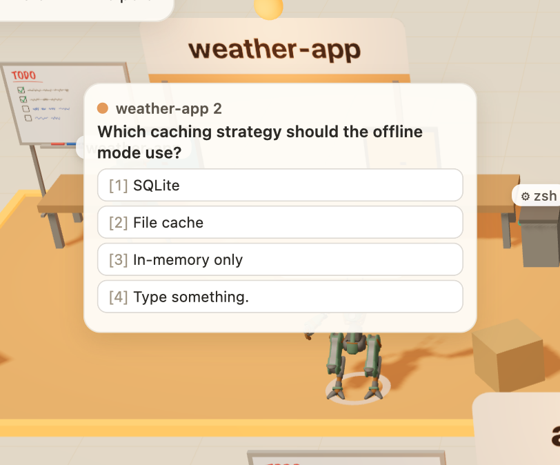

# Agent Workshop

**Claude Code oturumlarını bir robot atölyesi olarak gösteren, terminalleri de içinde barındıran macOS uygulaması.**

Her Claude Code oturumu atölyede bir robottur. Robotlar projelerine göre bölgelere ayrılır; çalışırken
tezgâhta iş yapar, seni beklerken el sallar, işi bitince dinlenir. Terminaller atölyenin üstünde yüzen
pencerelerdir: sürükle, büyüt, kenara yapıştır, sahneye dokununca hepsi animasyonla sol paneldeki
projelerine çekilir. Birden çok Claude hesabını, hangisini kullandığını fark etmeden aynı skill'ler,
MCP'ler ve hafızayla kullanırsın.

[English README](README.md)



---

## Neler yapıyor?

### 🤖 Robot atölyesi
- Açık her Claude Code oturumu bir robot; projelere (git köküne) göre bölgelere yerleşir.
- Durumlar anında görünür: **çalışıyor** (hangi aracı kullandığıyla), **seni bekliyor** (neyi beklediğiyle),
  **bitti**, **boşta**. Yardımcı ajanlar (subagent) robotun yanında küçük yardımcılar olarak çıkar.
- Bölge panelinde son araç çağrıları, açık `TODO.local.md` maddeleri ve git durumu.
- Akış: commit, push, pull ve dal değişikliği olayları sahnede ve olay akışında görünür.
- **6 farklı robot:** ana ajanlar için George, Mike, Stan; alt ajanlar için Leela, Android, Bolt.
  Her yeni oturum rolündeki robotlardan rastgele birini alır, o an atölyede olmayanlar önce gelir.
- **Kendi robotun:** üst çubuktaki **Robotlar** penceresinden bir `.glb` dosyası (en fazla 30 MB) ekle.
  Animasyonlar adlarına göre eşlenir (Idle, Walk/Run, Wave, Sit, Yes…); eksik olanların yerine robot
  kendisi sallanır, zıplar ya da eğilir. Hazır robotları aynı pencereden kapatabilirsin.

### 💬 Sahneden cevap


- İzin istekleri, sorular (tek/çoklu seçim, serbest metin, çok sayfalı) ve plan onayları projenin platformu
  üstündeki balonda çıkar. Bir seçeneğe tıkla (ya da 1–9'a bas), cevap ajana gider.
- **Her** oturumda çalışır — Agent Workshop'un kendi terminallerinde de, cmux gibi başka bir terminal
  uygulamasında da — küçük bir Claude Code `PermissionRequest` hook'u sayesinde (onayınla kurulur, bkz.
  [Bilgisayarında değiştirdikleri](#bilgisayarında-değiştirdikleri)). Terminaldeki menü de açık kalır;
  hangisi önce cevaplanırsa o geçer.
- Plan onayında "Planı aç" planı Markdown okuyucuda açar.

### 🪟 Yüzen terminal pencereleri


- Terminaller uygulamanın içinde, atölyenin üstünde: sürükle, kenarlardan/köşelerden boyutlandır,
  ekranın kenarına ya da köşesine sürükleyince yarım/çeyrek ekrana yapışır, çift tıkla tam ekran.
- Sahneye tıklayınca pencereler sol paneldeki kendi projelerine animasyonla çekilir; projeye tıklayınca geri gelir.
- Aynı projede istediğin kadar Claude oturumu, kabuk, salt okunur **Git** görünümü (değişen dosyalar,
  commit'ler, diff) ve **Markdown** okuyucu.
- Terminaller ayrı bir yardımcı süreçte (`atolye-host`) yaşar: Agent Workshop'u kapatıp açsan da oturumların sürer.

### 🔔 Seni bekleyen ajanı kaçırma
- Bekleyen Claude'un penceresi ve sol paneldeki etiketi yanıp söner, sesli uyarı çalar.
- Agent Workshop arka plandayken macOS bildirimi; bildirime tıklayınca doğrudan o terminale gidersin.
- Dock simgesinde bekleyen ajan sayısı.

### 💰 Token ve maliyet


- Her oturumun kullandığı token ve Anthropic API liste fiyatıyla karşılığı (yardımcı ajanlar dahil).
- Üst çubukta günün toplamı — kapanmış oturumlar ve bütün hesaplar dahil.
- Abonelikle kullananlar için bu bir fatura değil; hangi oturumun ne kadar iş yaptığını karşılaştırmak içindir.

### 👥 Birden çok Claude hesabı, tek çalışma ortamı
- Profiller (`Profil 1`, `Profil 2`, …) üst çubuktaki menüden yönetilir; yeni Claude oturumları seçili
  profille açılır, istersen tek pencereyi başka profille açarsın.
- Bütün profiller **aynı** skill'leri, plugin'leri, ayarları, hafızayı, komut geçmişini ve dosya geçmişini kullanır.
- MCP sunucuları ve proje izinleri profiller arasında otomatik eşitlenir: bir hesapta eklediğin MCP
  diğerinde de olur. Hesabın kimlik bilgilerine dokunulmaz.
- Her profilin 5 saatlik ve haftalık limiti görünür; %90'ı geçince Agent Workshop uyarır.
- Profile beklenen hesabı yazarsan, yanlış hesapla girişliyse uyarır; "Giriş yap" giriş sayfasını o e-postayla açar.

### 🟩 GitHub panosu


- Üst çubuktaki **GitHub** düğmesiyle açılan kişisel pano: son bir yılın katkı ısı haritası, bugün,
  son 7 gün, kesintisiz seri ve en uzun seri; commit / PR / inceleme toplamları.
- Son 30 günde çalıştığın depolar, gizli depolar dahil.
- Giriş GitHub'ın cihaz akışıyla: Agent Workshop bir kod gösterir, tarayıcıda onaylarsın. Şifre girilmez;
  anahtar Mac'in Anahtar Zinciri'nde durur ve Agent Workshop GitHub'a yalnız okuma isteği gönderir.

---

## Kurulum

**Gerekenler:** macOS 26, Xcode 26 (Swift 6.2), [Claude Code](https://claude.com/claude-code), `jq`
(limit göstergesi için, `brew install jq`).

```sh
git clone https://github.com/alican645/agent-workshop.git
cd agent-workshop
./scripts/build-atolye.sh --install   # "build/Agent Workshop.app" oluşturur ve ~/Applications'a kopyalar
open ~/Applications/"Agent Workshop.app"
```

İlk açılışta Agent Workshop, Claude Code ayarlarına dokunmadan önce sorar; seçimini sonradan uygulama
menüsündeki **Claude Code entegrasyonu…** ile değiştirebilirsin.

Arayüz Türkçe ve İngilizce: uygulama menüsündeki **Dil** ile Sistem / English / Türkçe seçilir (sistem dili
Türkçe değilse İngilizce açılır). Çeviriler `Sources/Atolye/Web/i18n/en.json` dosyasında; anahtar Türkçe metindir
ve hem Swift arayüzü (`L("…")`) hem sahne (`t('…')`) aynı dosyayı kullanır. Eksik çeviriyi testler yakalar.

Uygulama Apple geliştirici imzası taşımaz (yerelde ad-hoc imzalanır). Kaynaktan derleyince sorun
olmaz; derlenmiş bir `.app` indirip açarsan macOS uyarı verir — sağ tık → **Aç** ile açabilirsin.

Testler:

```sh
swift test
node --test Tests/web/*.test.mjs   # sahne mantığı (robot seçimi, animasyon eşleme)
```

## Kısayollar

| Kısayol | İş |
|---|---|
| ⌘⇧T | Öndeki projede yeni Claude oturumu |
| ⌘T | Yeni terminal |
| ⌘W | Pencereyi kapat (çalışan bir şey varsa sorar) |
| ⌘M | Pencereyi projesine çek |
| ⌘1 … ⌘9 | N'inci pencereyi öne getir |
| ⌘\` · ⌘[ · ⌘] | Pencereler arasında dolaş |
| ⌃⌘S | Sol paneli göster / gizle |

## Nasıl çalışıyor?

Agent Workshop hiçbir yere veri göndermez; her şeyi Claude Code'un kendi yerel dosyalarından okur. Tek istisna,
giriş yaparsan GitHub panosunun GitHub'dan kendi katkılarını okumasıdır.

- **Oturum durumu:** Claude Code'un oturum kayıtları (`<profil>/sessions/<pid>.json`) saniyede bir taranır.
- **Ne yapıyor:** sohbet kayıtlarının (`projects/**/*.jsonl`) sonu artımlı okunur; araç çağrıları, yardımcı
  ajanlar ve token kullanımı buradan çıkar.
- **GitHub panosu:** yalnız sen giriş yaparsan; GitHub GraphQL (katkı takvimi) ve commit araması, salt okunur.
- **Git:** `git` komut satırı, kilit almadan (`--no-optional-locks`) ve salt okunur.
- **Seçenek menüleri:** `PermissionRequest` hook'u isteği yerel bir Unix soketiyle uygulamaya iletir ve
  cevabını bekler. Agent Workshop'un kendi terminallerindeki oturumlarda görünen ekran da okunur.
- **Limitler:** Claude Code'un durum satırı betiğine eklenen küçük bir blok, `rate_limits` bilgisini profil
  başına bir dosyaya yazar.

### Bilgisayarında değiştirdikleri

Yalnız onayınla (ilk açılışta ya da **Claude Code entegrasyonu…** menüsünden). Değişen her dosyanın aslı önce
`~/Library/Application Support/Atolye/yedek/` altına kopyalanır; kapattığın seçeneğin eklediği şey geri silinir.

- `~/.claude/settings.json`: `PermissionRequest` hook'u (terminalden verilen cevabı fark etmek için
  `PostToolUse`/`PostToolUseFailure` da) — komut `~/Library/Application Support/Atolye/bin/atolye-hook`.
  Uygulama kapalıyken hook hiçbir şey yapmaz; senin hook'larına dokunulmaz.
- `~/.claude/statusline-command.sh` sonuna limit bloğu.
- Ek profillerde ortak öğeler için ana `~/.claude` klasörüne sembolik bağlar.
- Profillerin `.claude.json` dosyalarında yalnız MCP ve proje izni alanları (üç yollu birleştirme;
  Claude dosyayı o an yazıyorsa o tur atlanır).

## Proje yapısı

| Hedef | Ne |
|---|---|
| `Atolye` | SwiftUI uygulaması; sahne `WKWebView` içinde three.js ile çizilir (`Sources/Atolye/Web`) |
| `atolye-host` | Terminalleri barındıran arka plan yardımcısı (Unix soketi üzerinden) |
| `atolye-hook` | Claude Code hook'u: seçenek menüsünü uygulamaya iletir, cevabı geri verir |
| `AtolyeHostKit` | Yardımcının ve hook'un sunucu/istemci kodu, [SwiftTerm](https://github.com/migueldeicaza/SwiftTerm) ile |
| `AtolyeCore` | Arayüzden bağımsız çekirdek: oturum tarama, git, kullanım/maliyet, profiller, eşitleme |

Tasarım notları ve uygulama planları `docs/superpowers/` altında.

## Teşekkürler

- [three.js](https://threejs.org) (MIT) ve robot modeli *RobotExpressive* — Tomás Laulhé (Quaternius), düzenleme
  Don McCurdy (CC0).
- Robot modelleri George, Leela, Mike, Stan (*Animated Mech Pack*) ve Android (*Cyberpunk Game Kit*) —
  [Quaternius](https://quaternius.com) (CC0). Ayrıntı: `Sources/Atolye/Web/models/LICENSE.txt`.
- [SwiftTerm](https://github.com/migueldeicaza/SwiftTerm) (MIT), [marked](https://marked.js.org) (MIT).
- Bazı fikirler (token/maliyet takibi gibi) Orbiterm'den esinlendi; kod paylaşılmadı.

Agent Workshop bağımsız bir projedir; Anthropic ile bir bağlantısı yoktur.

## Lisans

[MIT](LICENSE) © 2026 Ali Can Aydın
